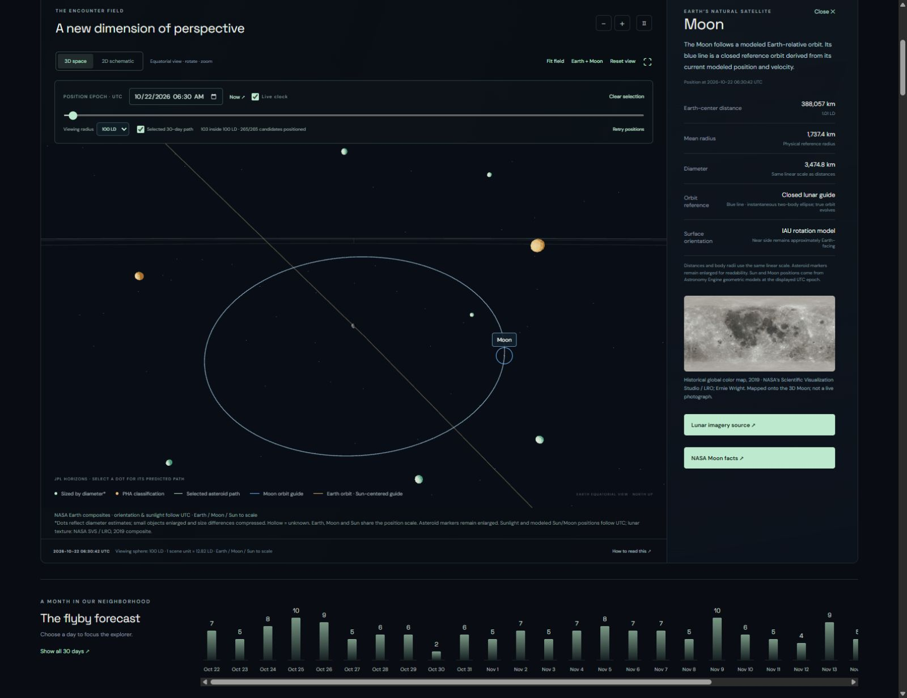

# Perigee — NASA Asteroid Explorer

An interactive learning project by Zak Rademacher that turns NASA/JPL data into an explorable 3D view of near-Earth asteroid encounters.

**[Open the live explorer](https://perigee.zakjrademacher.workers.dev/)** · [Data methodology](docs/METHODOLOGY.md) · [Run locally](#run-and-verify)



## What you can explore

- Thirty-day NASA encounter windows with search, numerical filters, daily counts and CSV export.
- Earth-relative 3D positions at one visible UTC time, with a predicted 30-day path for the selected asteroid.
- Estimated sizes, speeds, closest-approach distances and PHA classifications, with their limitations explained.
- Reviewed historical radar/spacecraft imagery and separately labeled NASA archive search candidates.

NASA NeoWs supplies the encounter catalog; NASA/JPL Horizons supplies geometric positions and velocities. The app validates the returned coordinate frame, units, object identity and sample coverage before displaying a position. Missing coordinates stay unavailable. This is a visualization of published predictions, with caches and interpolation, rather than a continuously moving measurement feed.

## Project role and tools

Zak directed the concept, feature requirements and visual iterations. This is an independent learning demonstration.

The interface uses HTML, CSS and JavaScript; Three.js renders the viewer. A Cloudflare Worker retrieves and caches Horizons data through a same-origin endpoint. Node.js runs the build and 67 automated tests. No database or private NASA API key is required.

## Use

[Open Perigee](https://perigee.zakjrademacher.workers.dev). The tracker is public. Choose a 30-day encounter window. The 3D viewer queues every unique candidate matching the filters for JPL states, loading serially with visible progress. It shows only positioned objects within the chosen Earth-centered viewing radius. Every positioned dot uses the same UTC epoch; unavailable states are omitted. Rotate, zoom or select a dot/catalog row. Only the selected object's next 30 days of Earth-relative path appear. Clear selection removes the path. Use the position time/slider or Now to change the epoch. Live clock advances the shared UTC epoch when the current time lies in the loaded window. Editing the time or slider pauses it; Now resumes live time. Historical and future windows remain fixed.

The default 3D view preserves actual JPL directions and distance ratios with one **linear** scale. Earth, Moon and Sun use physical radii on the same scale as distances; asteroid markers are enlarged for visibility; Earth uses historical NASA composites, with sidereal orientation and date-based sunlight at the shared UTC epoch. Earth orientation is an educational approximation, without measured Earth-orientation corrections. Circular grid lines are distance guides. The separate **2D schematic** retains illustrative bearings and log closest-approach distances. The source/frame and epoch are visible, so these modes cannot be mistaken for one another.

Filters refer to close-approach dates/distances and estimated size, not current distance. Window metrics and CSV export summarize encounter data. The selected profile separately shows Earth distance and XYZ at the position epoch. Historical radar/spacecraft images include source, credits and observation dates; automatic image-search matches are explicitly unverified candidates.

## Data and accuracy

- [NASA NeoWs](https://api.nasa.gov/): a 30-day timeline and seven-day candidate buffers on either side, in seven serial requests, a public demo key or optional server-side NASA_API_KEY secret, 15-minute catalog caches with a personal key (one hour with the demo key) and explicit refresh. On failure, a dated NASA snapshot is labeled and its actual window adopted.
- [NASA/JPL Horizons](https://ssd-api.jpl.nasa.gov/doc/horizons.html): numeric SPK-ID lookup, Earth body center `500@399`, geometric vectors (`VEC_CORR=NONE`), ICRF/J2000 ecliptic orientation, km and km/s, UT/UTC. Sixty days of hourly states support positions throughout the 30-day encounter window and a 30-day future path from any epoch in it.
- Positions between JPL samples use cubic Hermite interpolation with the supplied velocities. They are computed predictions, not direct live measurements. No universal interpolation error bound or uncertainty envelope is claimed. Very close flybys may need finer sampling for precision work. Source states are never extrapolated beyond coverage.
- The drawn path is a finite Earth-relative trajectory, not a closed orbit around Earth or a complete heliocentric orbit. PHA classification is not an impact probability.
- Both browser and server serialize their JPL requests, deduplicate pending lookups, cache successful data for an hour and handle service backoff. The Worker sends an application-specific User-Agent with the public project owner's GitHub contact. JPL is called server-side rather than directly from the browser. An API version/frame/coverage mismatch fails closed.
- Missing JPL states never receive fabricated positions. NeoWs fallback records can remain in the catalog while JPL positions are unavailable. Dates supported by this ephemeris viewer are 1962–2099.

## Run and verify

This version uses a small ES-module Worker to serve the app and its same-origin Horizons endpoint. A plain Python static server cannot supply that endpoint. With Node available:

```powershell
node tools/build-worker.mjs
node tools/validate-worker.mjs
node --test tests/model.test.mjs tests/viewer-media.test.mjs tests/ephemeris.test.mjs tests/worker.test.mjs tests/earth.test.mjs tests/catalog.test.mjs tests/field.test.mjs
node tools/serve-worker.mjs
```

Open http://127.0.0.1:8790/. No dependency installation or private NASA key is required for this local preview. The deterministic build embeds the frontend files into `dist/server/index.js`. Frontend source remains under `dist/`; generated server output is ignored in Git.

## Deploy to Cloudflare

Node.js 22.18 or later and pnpm are required for the pinned Cloudflare build tooling. Install dependencies with `pnpm install --frozen-lockfile`. The dependency build allowlist permits only the official `workerd` installer. Authenticate once with `pnpm exec cf auth login`; credentials stay in Cloudflare's user configuration outside this project.

```powershell
pnpm run build:cloudflare
pnpm test
pnpm exec cf deploy --prebuilt --mode production --dry-run
pnpm exec cf deploy --prebuilt --mode production
```

`cloudflare.config.ts` names the public Worker `perigee` and enables its `workers.dev` route, logs and sampled traces. The Vite plugin bundles the same portable Worker to `.cloudflare/output/v0/`, separate from the existing frontend source in `dist/`. Generated output, local caches and credentials are excluded from Git. `pnpm run deploy:cloudflare` rebuilds and deploys in one step; run the tests first. Check the signed-in account with `pnpm exec cf auth whoami` before publishing from another machine.

An earlier Sites deployment is retained separately. Future changes require publication to each host intended to receive them; publishing to one does not update the other. Cloudflare is the primary shared URL. No custom domain or paid resource is required by this configuration.

## Source map

- `dist/model.js`, `app.js`: encounter normalization, filtering, UI and source handling.
- `dist/ephemeris.js`: validated client loader, shared linear transform, interpolation and future tracks.
- `worker/horizons.js`, `worker/index.js`: validated Horizons query/parser, cache/queue and same-origin service.
- `dist/viewer3d.js`, `viewer.css`, `position.css`: real WebGL viewer, position clock and selected path.
- `dist/media.js`, `assets/provenance.json`: reviewed imagery and conservative archive candidates.
- `dist/vendor/`: unchanged Three.js 0.186.1 files, license and verified npm/file integrity.
- `tests/fixtures/horizons-2010al30-60d.json`: unmodified real JPL response used for parser and numerical checks.
- `dist/data/horizons-example.json`: parsed, dated example; reused only while it meets the same one-hour freshness check as any response.
- `tools/`: deterministic build, local Worker preview, validator, explicit NASA snapshot refresh and reproducible vendor download.
- `docs/METHODOLOGY.md`, `docs/images/`: data methods and a screenshot of the published explorer.

This is an independent educational project, not a NASA product.

## Earth and marker sizes

The 3D globe uses original NASA Blue Marble surface/cloud textures and 2012 NASA/NOAA night lights, with a shader for sunlight, a day/night boundary and atmospheric rim. These are historical composites, not current weather. Astronomy Engine 2.1.19 computes sidereal rotation, precession, nutation and Sun direction at the same UTC epoch as the asteroid markers. Coordinates pass through J2000 ecliptic and the existing right-handed renderer transform. The initial view and **Reset view** frame Earth and the lunar orbit, centered on Earth. **Fit field** shows the full asteroid sphere.

Both marker views use the midpoint of NASA's estimated minimum/maximum diameter on a fixed square-root scale (5–30 screen pixels). The scale remains stable across filters and selection. Unknown or invalid estimates use a hollow marker. Marker sizes are deliberately exaggerated and do not share the position-distance scale. Selection adds a ring without inflating the diameter marker. The 3D proxy scales with camera depth to retain the encoded screen diameter when zooming.

[Earth orientation, sources and validation](docs/EARTH.md). Texture hashes/credits are in `dist/assets/provenance.json`; the unmodified MIT astronomy runtime and its integrity record are in `dist/vendor/`.

The default 3D view uses the true equatorial frame of the shared epoch, with Earth north up and a nearly equator-level camera. The full scene rotates together; raw readouts remain J2000 ecliptic. Opaque markers and path segments are hidden by Earth. See the Earth guide for display-size limits and 60-day JPL coverage behind the selected 30-day track.

If OneDrive placeholders cause the CLI to report a symlink in Build Output, run `python tools/stage_cloudflare.py --deploy` after building and testing. It copies only generated deployment files as regular bytes into a fresh local temporary folder, verifies their hashes, performs a dry-run and publishes with the project’s pinned CLI. Source and deployment records remain in OneDrive.

The viewing radius fixes the distance scale throughout scrubbing, loading and selection. Default: 100 LD; choices: 25, 50 and 100 LD. Earth uses its 6,371 km mean radius on the position scale. **Fit field** frames the asteroid sphere; **Reset view** returns to the Earth-centered lunar view. The selected trajectory is clipped into independent line segments at the sphere boundary.

The 3D field uses all unique buffered candidates matching the filters, with no 60-marker cap. Table, metrics and CSV retain only close approaches within the visible timeline. The private NASA key is a separate Cloudflare secret; catalog responses refresh after 15 minutes with that key, and JPL vectors are reused for an hour. A saved fallback adopts its actual dated coverage. See [viewing-field behavior](docs/VIEWING_FIELD.md).

The catalog endpoint returns only fields used by the explorer. NASA API links and unused provider metadata are removed before responses enter public caches, so upstream credential URLs are not passed to browsers. The personal NASA key is configured separately as a Cloudflare secret and is never included in repository files.


While Live clock is enabled and the page is visible, the app checks once per minute whether the catalog refresh interval has elapsed. Background refresh preserves the selected object and scrub time for the same window. Likely nearby candidates are prioritized for downloads; the priority score never substitutes for JPL coordinates. IndexedDB stores successful vectors beyond localStorage's small string quota, with a one-hour source-timestamp expiry and graceful fallback if storage is unavailable. Existing marker meshes are reused, and decorative star redraws are limited to 20 frames per second without repeatedly projecting DOM marker labels.


Earth (6,371 km), Moon (1,737.4 km) and Sun (695,700 km) use physical mean/nominal radii on the same linear distance scale. Astronomy Engine supplies geometric Sun/Moon positions and the IAU lunar surface orientation at the shared UTC epoch. The Moon uses the original credited NASA SVS 2019 CGI Moon Kit composite; it is historical imagery, not a live photograph. A smooth, closed blue lunar orbit guide distinguishes the Moon from mint selected-asteroid trajectories. The initial view, **Earth + Moon** and **Reset view** keep Earth at the camera center and frame the lunar orbit. **Fit field** shows the full viewing sphere; zooming out can reveal the Sun at its real modeled distance. There is no separate solar-system mode, gravity vector display, View settings, Earth close-up or Fit Earth + Sun control. Clicking the Sun or Moon opens its current distance, physical radius and source details in the fixed-height side panel. Repeating a body/asteroid selection clears it. Asteroid dots remain exaggerated for visibility.

The detail panel keeps its outer height (1,020 px desktop; 640 px on narrow screens) and scrolls internally. Table selection no longer scrolls the page automatically. Reset view shares font size, weight, padding and color with its neighboring buttons.

Earth also has a closed amber orbit guide around the Sun. It is calculated from the modeled heliocentric Earth state and translated into the Earth-centered scene, so Earth remains at the origin. Zoom out to see the full orbit. Both blue lunar and amber Earth guides are instantaneous two-body references, not full future integrations; actual ephemerides remain independently modeled.
