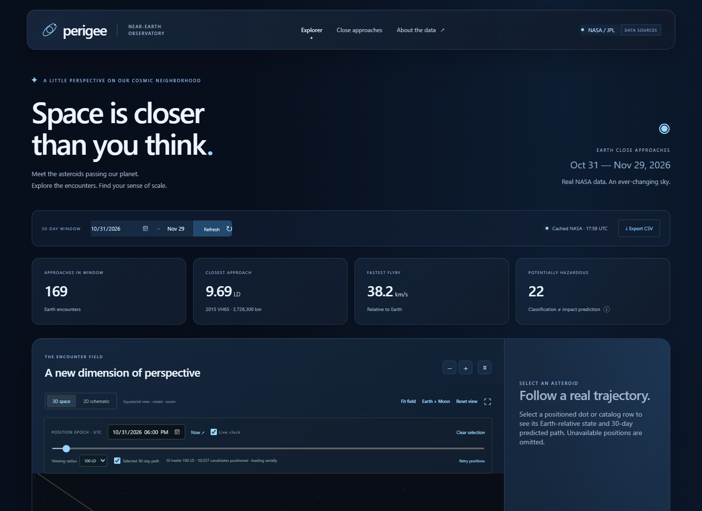

# Perigee — NASA/JPL Asteroid Explorer

Perigee turns NASA/JPL encounter data into an interactive view of asteroids passing near Earth. You can explore a 30-day timeline, select an object, and follow its predicted path relative to Earth.

I developed substantial parts of the JavaScript and Worker implementation alongside the concept, feature requirements, and visual direction. The project uses Three.js for the 3D view and a Cloudflare Worker for the data endpoints.

**[Open the live explorer](https://perigee.zakjrademacher.workers.dev/)** · [Methodology](docs/METHODOLOGY.md) · [Run locally](#run-and-verify)



## Explore the data

- Search and filter a 30-day encounter window, inspect daily counts, and export the table as CSV.
- View available JPL positions at one shared UTC time. Select an asteroid to see its next 30 days of predicted Earth-relative trajectory.
- Inspect estimated diameter, speed, closest approach, and potentially hazardous asteroid classification alongside the source information.
- View reviewed radar and spacecraft imagery. Automatic NASA archive matches are labeled as unverified candidates.

The 3D view uses one linear distance scale. Earth, Moon, and Sun use physical reference radii; asteroid markers are enlarged so they remain visible. The separate [2D schematic](docs/images/perigee-schematic-studio.png) uses illustrative directions and logarithmic closest-approach distances.

## Reading the view

Choose a window, then rotate, zoom, or select a dot or table row. The default view centers Earth and frames the lunar orbit. **Reset view** returns there; **Fit field** frames the asteroid viewing sphere. Choose a radius of **25, 50, or 100 lunar distances**; one LD is 384,400 km.

The time slider changes the shared position epoch. Editing it pauses **Live clock**; **Now** resumes current time when it falls within the loaded window. Clicking the selected object again or using **Close** clears its details and path. Sun and Moon also have selectable profiles. The blue lunar and amber Earth-orbit guides are instantaneous two-body references, rather than full future simulations.

Encounter filters describe closest approach, not the object's current distance. The 3D field only shows positioned catalog candidates within the chosen radius. It isn't a complete inventory of everything near Earth. [Timeline and viewing-field guide](docs/VIEWING_FIELD.md).

## Where the positions come from

NASA NeoWs supplies encounter records. JPL Horizons supplies positions and velocities relative to Earth's center, in J2000 ecliptic coordinates. The app checks object identity, frame, units, and coverage before using them. Between hourly samples it uses cubic Hermite interpolation; it never extrapolates missing positions.

These are published predictions evaluated at a chosen time, rather than live measurements. Catalog and position caches have separate expiry periods. Failed requests leave positions unavailable, and a fallback catalog is labeled with its actual dates. The selected path is Earth-relative, not a closed orbit around Earth. PHA classification is not an impact probability.

[Request, interpolation, and cache details](docs/METHODOLOGY.md) · [Earth orientation, imagery, and marker sizes](docs/EARTH.md)

## Run and verify

With Node available, run from the repository root:

```powershell
node tools/build-worker.mjs
node tools/validate-worker.mjs
node --test tests/model.test.mjs tests/viewer-media.test.mjs tests/ephemeris.test.mjs tests/worker.test.mjs tests/earth.test.mjs tests/catalog.test.mjs tests/field.test.mjs
node tools/serve-worker.mjs
```

Open http://127.0.0.1:8790/. This local preview needs no dependency installation or private NASA key. A plain static server won't supply the required data endpoint. The build embeds frontend files from `dist/` into the generated Worker.

## Deploy to Cloudflare

For the pinned deployment tools, use Node.js 22.18+ and pnpm. Install with `pnpm install --frozen-lockfile`, authenticate with `pnpm exec cf auth login`, and check the account with `pnpm exec cf auth whoami`.

```powershell
pnpm run build:cloudflare
pnpm test
pnpm exec cf deploy --prebuilt --mode production --dry-run
pnpm exec cf deploy --prebuilt --mode production
```

`cloudflare.config.ts` defines the public Worker and its `workers.dev` route. Credentials and generated output stay outside Git. An optional `NASA_API_KEY` belongs in a server-side secret; no key value is included in the frontend. The demo-key fallback works without one.

If OneDrive placeholders cause a Build Output symlink error, `python tools/stage_cloudflare.py --deploy` stages and hash-checks regular files in a temporary folder before a dry-run and publication. Run it only when intending to deploy.

## Source and maintenance

Frontend and viewer: `dist/`. Data endpoints: `worker/`. Tests and retained JPL fixtures: `tests/`. Build, validation, and preview commands: `tools/`. [Visual maintenance](docs/VISUAL_DESIGN.md) · [Published browser checks](evidence/visual-refresh-2026-10-31.json).

NASA imagery credits and hashes are in `dist/assets/provenance.json`. Three.js and Astronomy Engine are vendored with their licenses and integrity records. Earth and Moon imagery are historical composites, not current camera feeds. This is an independent visualization project, not a NASA product or a precision navigation or impact-assessment tool.
